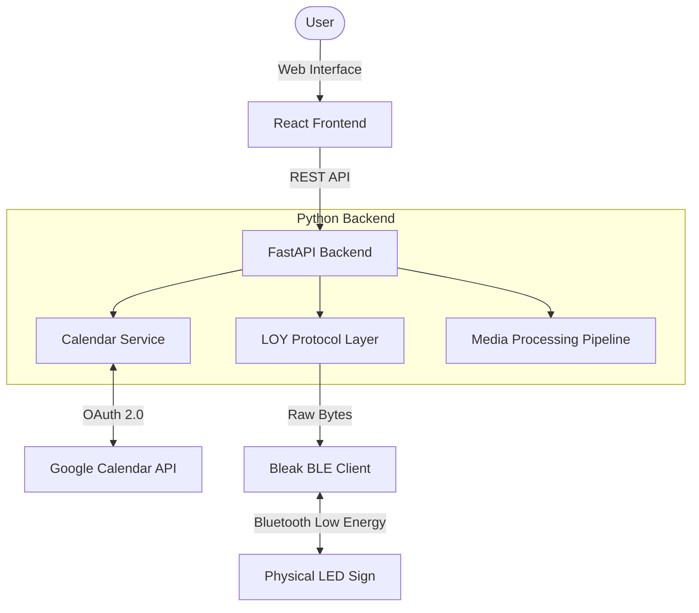

# System Architecture

This application consists of a decoupled frontend and backend that communicate via a REST API, enabling robust management of compatible Bluetooth LED displays from a standard web browser.

## High-Level Components

### 1. React Frontend (`client/`)
- A single-page application built with React and Vite.
- Manages the user interface, preview simulations, preset management, and local configuration.
- Handles interactions with the user and polls the backend for Bluetooth status and Calendar events.
- Provides an accurate 64x20 content preview, where immediate browser-side editor previews closely simulate the backend logic, and saved/live previews directly reflect the actual processed hardware output.

### 2. Python Backend (`server/`)
- A RESTful API built with FastAPI and Uvicorn.
- Runs locally and acts as the bridge between the web browser and the Bluetooth hardware.
- **Key Subsystems:**
  - **Bluetooth Manager (`main.py`):** Uses the `bleak` library to handle background scanning, connection persistence, and asynchronous command queuing.
  - **Media Pipeline:** Uses Pillow and OpenCV to rasterize, resize, crop, and process images, GIFs, and videos into 64x20 frame/pixel representations, which are then encoded into protocol-appropriate bitmap commands or saved payloads.
  - **LOY Protocol Layer (`loy_web_protocol.py`):** Encodes the raw media and text payloads into the proprietary byte protocol (including chunking, CRC checksums, and framing) required by the target hardware.
  - **Calendar Integration (`calendar_service.py`):** Integrates with the Google Calendar API via OAuth to fetch upcoming events. It dynamically extracts event titles and cleans them for automated pushes to the sign.

### 3. Google Services (External)
- The application integrates with Google Cloud via OAuth 2.0.
- Supports both local `credentials.json` for personal use and environment-injected credentials for hosted or distributed deployments.

### 4. Hardware Display (External)
- The physical 64x20 LED sign.
- Connects to the host running the Python backend over Bluetooth Low Energy (BLE).
- Receives and executes raw byte commands formatted by the `loy_web_protocol.py` layer.

## Architecture Diagram

